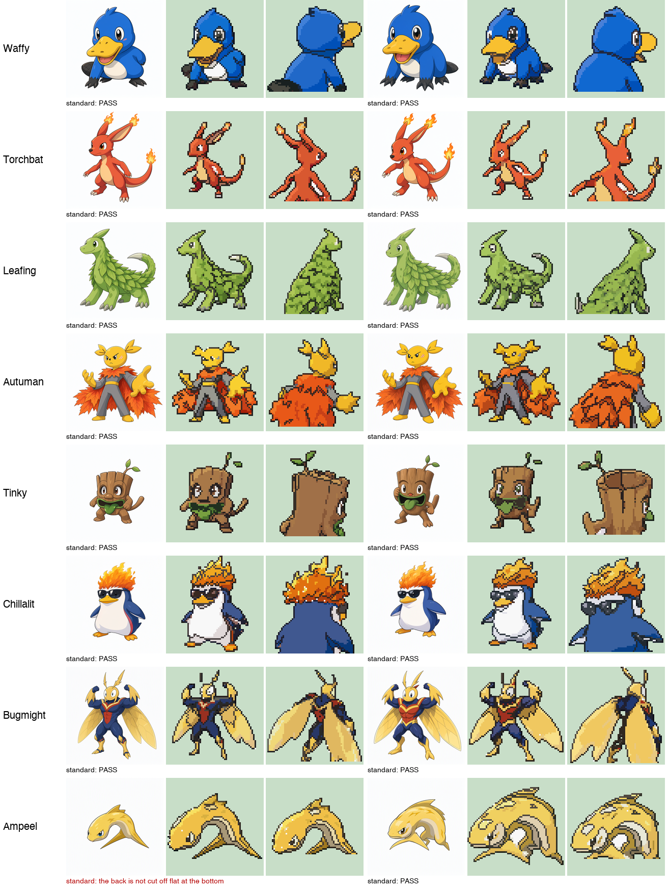
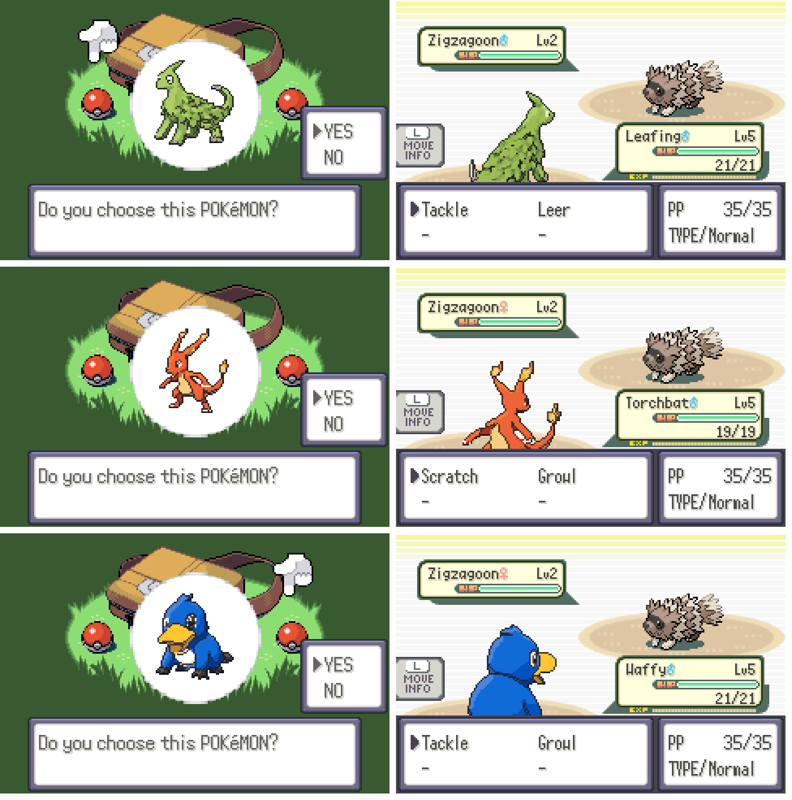
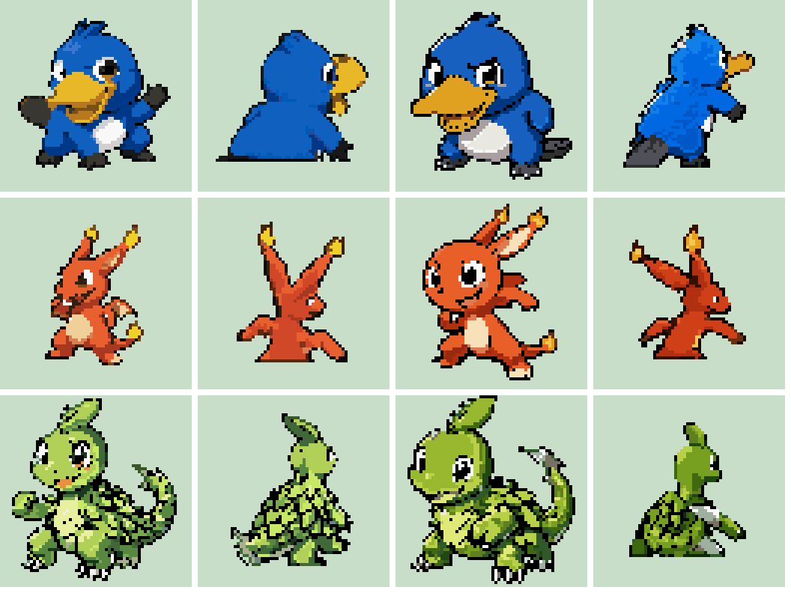
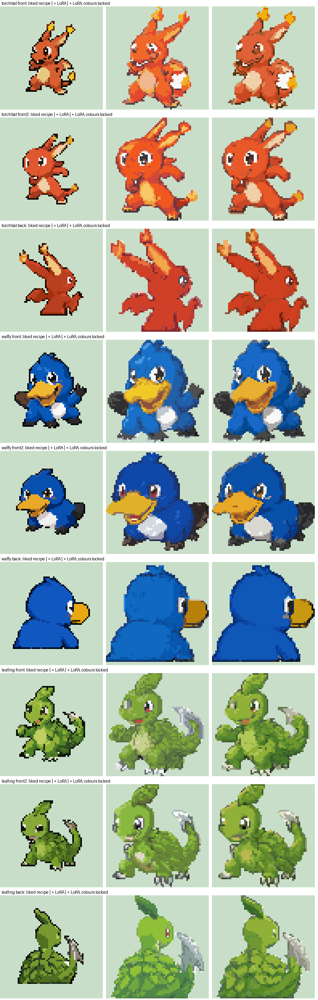
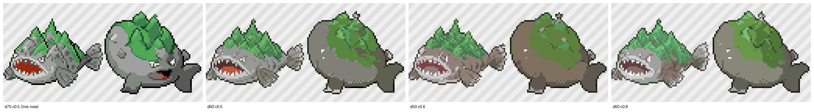
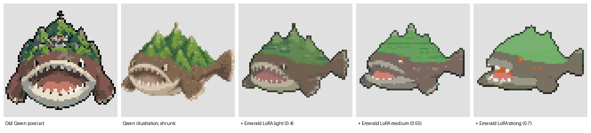
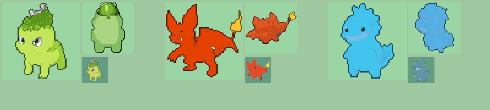
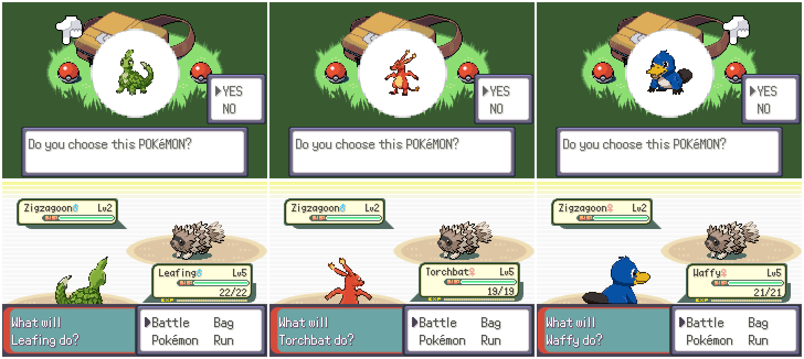

# Pictures and sounds: sprite style, studio, image generator, shinies, cries

How our sprites look and get made (the Sigma style, the sprite studio on the website, ComfyUI on the Legion, the formats the game needs), and the shiny and cry makers. The LoRA training log is its own page: [LORAS.md](LORAS.md).

Contents:
- [The Sigma sprite style](#the-sigma-sprite-style)
- [The sprite studio](#the-sprite-studio)
- [The trainer studio](#the-trainer-studio)
- [Sprites](#sprites)
- [The image generator (ComfyUI)](#the-image-generator-comfyui)
- [Shinies](#shinies)
- [Cries](#cries)


---

## The Sigma sprite style
*(was `docs/SPRITE_STYLE.md`)*

**The DS pipeline is the current one:** since 2026-10-05 the website's sprite studio only makes DS
(Origin HeartGold, 80x80) sprites, drawn by Qwen-Image-Edit; it is described under
[The DS (Origin HeartGold)](#the-ds-origin-heartgold) below. Everything above that section describes the
earlier GBA style (64x64), built by our own renderer. It is no longer the default for new sprites,
but the code and the test set are kept.

The GBA style: every Sigma Pokemon's battle sprites were made the same way, so the whole dex has one
look. This part says what the standard was, how the sprites were made, and how a sprite is checked. In the
sprite studio it was the style "Sigma sprite style" (`sprite-official`), the default from 2026-10-03
until the DS pipeline replaced it.



Eight Pokemon with very different designs, two attempts each: the artwork Qwen drew, then the
front and back sprites built from it. 15 of the 16 pass every check; Ampeel's first back fails
(Qwen drew the eel from the side, not from behind), so the studio would put it last. In the
game, next to the game's own Zigzagoon:



### The standard

The standard is what the games' own sprites do, measured: the 844 front sprites and 843
front/back pairs in pokeemerald-expansion's graphics were measured on 2026-10-03 (locally, for
the numbers only; no Nintendo picture is in this repository). Ours must fall in the range that
95% of theirs fall in. A typical official sprite, and ours (median of eight test Pokemon):

| | games' sprites (5% / median / 95%) | ours |
|---|---|---|
| colours | 10 / 13 / 15 | 15 |
| outline brightness (0 black, 255 white) | 23 / 44 / 73 | 48 |
| share of the outline that is black | 0.28 / 0.54 / 0.84 | 0.61 |
| inner lines (share of the inside) | 0.05 / 0.11 / 0.18 | 0.05 |
| single-pixel texture | 0.06 / 0.10 / 0.17 | 0.04 |
| shades per colour | 2.0 / 2.8 / 4.7 | 3.0 |

Ours have a little less single-pixel texture and fewer inner lines than the games: shades come
in clusters on purpose, because scattered shade pixels and lines where a shadow starts read as
mess on our sprites (the group's verdict, 2026-10-03).

What that means for a sprite:

- **Frame:** 64 x 64 pixels; front and back share one palette of at most 15 colours.
- **Size:** by how much of the frame the creature covers, not by its longest side, as the games
  do: measured on their 45 starter sprites, first stages cover 764 pixels, middle 1224, final 1962;
  ours a quarter more (`sprite_area` in `scripts/sprite_worker.py`, by base stat total). A compact
  creature and a long one of the same stage then look the same size.
- **Front:** three-quarter view turned to the left, the whole body, an expressive battle pose.
- **Back:** seen over the shoulder, drawn closer than the front and cut off flat at the bottom.
- **Outline:** closed; nearly black on the shadow side (about half of the games' outlines are
  darker than brightness 30, which gives the sprites their "pop"), a muted dark tone of the part
  on the lit side. Lines between parts and inner lines (creases, mouths) are
  dark tones of the part, not black.
- **Shading:** four tones per part (shadow, base, light, a rare highlight), shadows a little
  cooler and lights warmer. Light comes from the upper left across the whole part, and shade
  comes in clusters, not in scattered pixels.
- **Face:** every eye has a dark pupil and a light glint.

`standards()` in `scripts/sprite_quality.py` checks these. 77% of the games' own sprites pass it
(the rest are mostly eyeless or floating designs); an attempt of ours that fails it goes to the
back of the queue and says why.

### How a sprite is made

1. **Official-style artwork.** Qwen-Image redraws the group's concept art (up to three
   reference pictures) as official Pokemon artwork: clean thin outlines, flat cel shading, and
   sprite proportions - a head about 40% of the height with a big, clear face - because a face
   needs pixels: at normal proportions a head is 12 pixels wide and brows and mouth drop out. Then it
   draws the same creature from behind, using its new front picture as the reference, so front
   and back match. Prompts: `official_front`, `official_back` and `official_poses` in
   `data/sprite_prompts.yaml`.
2. **Built pixel by pixel.** `scripts/pixel_render.py` does not shrink the artwork (that turns
   lines and faces to mud). It works in seven fixed steps, each with one job, and all its numbers
   are in one place (`STYLE` and `RAMP` at the top of the file, each with where it comes from):
   1. *segment* the artwork into silhouette, ink (dark and thin) and parts. A part is one colour
      in all its light and shadow (grouped by hue and colourfulness; greys by their lightness),
      so light and shadow of one colour never get a line between them. Wide dark areas such as
      black claws or sunglasses are parts, not ink; likewise a light area thinner than half a
      sprite pixel (rim light, shine) is lighting, not a part.
   2. *sample* it onto the sprite grid: part, lightness and ink for every pixel. Anything thinner
      than a sprite pixel (antennae, thin horns, tail tips, narrow stripes) would drop out, so it
      is traced to its middle line and drawn as a one-pixel line, as spriters draw them, and kept
      through the clean-up.
   3. *shape*: fill notches, remove spurs, round doubled corners (the pixel-perfect rule),
      let specks of a part join their surroundings.
   4. *face*: each eye is redrawn from the artwork: the eye white with the iris and pupil inside
      it, and the glint the artwork has. Rules that keep it from ever drawing a false eye: an eye
      has a pupil (a white without one is a horn or a tooth); a dark blob is an eye only if the
      artwork has a glint in it (else it is a tail, a claw or a marking); glints are never
      invented. Every other mark in the face that differs from the skin around it - a blush,
      a mouth, teeth, brows - keeps at least one pixel (detail ranked by recognition, not by
      area, as spriters do). A mark takes the nearest colour the sprite already has; only true
      accents (a pink blush) get palette slots of their own, at most three, so a detailed
      creature does not lose its body colours. Only in the upper part of the creature.
   5. *tones*: every pixel takes the tone of its part (shadow, base, light, highlight, line or
      outline) nearest to what the artwork shows there; where a dark stroke runs through a pixel
      the stroke wins. The artwork's detail decides, the ramps keep it clean.
   6. *lines*: coloured outline (darkest on the shadow side), lines between parts that differ,
      and the artwork's inner lines (scales, wood grain, creases) traced as clean one-pixel lines:
      every ink stroke is thinned to its middle line and laid on the grid, without doubled corners.
   7. *palette*: the renderer fits every part's ramp into 15 colours itself, and the back uses
      exactly the front's colours.
   If the drawn creature comes out smaller than asked (thin tips drop out), it is drawn once
   more at the size that makes it fit. The icon (32 x 32) is built the same way.
3. **Checked.** `standards()` in `scripts/sprite_quality.py` measures each attempt against the
   standard above. The worker makes twice as many attempts as asked for and hands in the better half;
   an attempt that misses the standard goes to the back and says why in its notes.
4. **People choose.** The checks find technical faults, not a wrong design. The group picks the
   attempt that looks like their Pokemon, or comments on it for a redo.

The same request always gives the same sprites (the seeds come from the request number, and the
renderer is not random).

### The DS (Origin HeartGold)

`python scripts/sprite_batch.py NAME ... --gen 4` makes 80x80 DS sprites. Since 2026-10-05 the pixel
art is drawn by Qwen-Image-Edit, not built by our renderer (`scripts/ds_pixel.py`):

1. Qwen redraws the concept art as Diamond/Pearl-era official artwork that copies the design
   exactly (same face, same number of limbs; `official_front_gen4`, `official_back_gen4` in
   `data/sprite_prompts.yaml`), in a pose that shows its personality: the mon's own `ds_pose`, else
   one that fits its dex entry (category and Pokedex text are put in the prompt). No waving: the
   old generic "one arm raised" made every creature wave, and a pose that mentions a limb can make
   Qwen add one (Chillalit got a third flipper).
2. Our renderer makes a rough sprite from it: only its grey silhouette is used, for size, place and
   pixel grid (shown the rough sprite itself, Qwen copied its mess).
3. Qwen turns the artwork into a DS battle sprite inside that silhouette (three seeds).
4. Its picture is read back on the rough sprite's grid (96x96 cells, 15 colours, each cell its
   commonest colour), so nothing is redrawn or resized; the best front is picked by size, eyes,
   noise and colours kept.
5. The back is drawn by Qwen from the finished pixel front (same creature, same style) and the back
   artwork (for the markings on its back), at about HeartGold's median size, cut off by the bottom
   edge, and given the front's colours. The 32x32 menu icon is read from the chosen front picture.

Why: at the DS size our renderer's faces, hands and textures turned to specks, and the Pokemon
sprite LoRAs either lost the design (they draw from text; given a picture they keep only its
shape) or the outlines. Tested on 8 mons, 4 of them never tried before: all kept their design and
filled the frame. Sizes were measured on HeartGold's own 493 sprites (locally, from Arvind's dump;
nothing of them is in this repo, and no game sprite is ever shown to a model): fronts 68/74/78
pixels (first/middle/final stage), feet on the bottom row (our height value is 0).

The GBA path (the renderer and the test set below) is unchanged but no longer used for new sprites.

### The test set

`tests/sprite_style/` holds artwork for eight very different Pokemon (two attempts each, front
and back) and the sprites accepted for them. After any change to the renderer:

```bash
python scripts/check_sprite_style.py
```

It renders all 16, says which changed and by how many pixels, checks each against the standard,
and writes a sheet (art, front, back, reference) to `tests/sprite_style/sheet.png`. If the change
is wanted, `--update` makes the new sprites the reference. On 2026-10-03: 14 of 16 pass; both
Ampeels fail on the eye (its eye in the artwork is a tiny blue dot), one also on its back (drawn
from the side).

### Making one by hand

The studio does all of this. To build a sprite from a picture yourself:

```bash
python scripts/pixel_render.py art.png front.png --size 54
```

```bash
python scripts/pixel_render.py art_back.png back.png --size 54 --back --palette-from front.png
```

```bash
python scripts/sprites.py make waffy --front front.png --back back.png
```

### What helps

- Clear concept art: a front view, and if possible a back view and an action pose (like the
  character sheets for Leafing and Torchbat). Pictures with a lot of text work, but the creature
  should be big in them.
- A short look on the Pokemon's page (colours and the 2-3 things that must be there).
- A `signature` for detailed creatures (in `data/sprite_prompts.yaml` under the Pokemon): the
  features that must be big and clear on the sprite, e.g. "a huge toothy grin" or "pink blush on
  both cheeks". The artwork then exaggerates them, as a spriter would; on a 64-pixel sprite a
  detail the artwork draws small cannot be saved later.
- A `ds_pose` in `data/sprite_prompts.yaml` for creatures whose personality shows in a pose.

### Tried and dropped (2026-10-03)

Shrinking an illustration (with or without PixelOE), having the AI "clean up" a shrunk sprite,
the Pokemon sprite LoRAs (Emerald and Sprite XL, also with an IP-Adapter), and a free redesign
by the AI. They gave muddy faces, lost the group's design, or both. Comparison pictures are in
[The sprite studio](#the-sprite-studio).

---

## The sprite studio
*(was `docs/STUDIO.md`)*

On every Pokemon's page on the website there is a **Sprite studio**: ask the AI for sprites,
look at the attempts, comment on them, have them redone and approve one. Nobody needs
anything but the website.

### How to use it (studio v4, since 2026-10-15)

Arvind about v3: "hard to take in, you have to scroll; lots of times, make it one total time; editing an existing sprite
is stressful". v4 has the site's two screens:

- **Top screen: the sprite set as it is now** - FRONT, BACK, ICON and WALK (the walking sprite that follows the player,
  animated). Each shows the picked picture, or the one in the game now ("in the game"). **EDIT** under any of them opens
  the editor on it, also on the sprite in use. The dialog box says what happens and how long it takes **in all**
  ("Drawing 4 backs, then 4 icons. Ready in about 6 minutes (2 requests from others first)").
- **Bottom screen: one step at a time** - 1 PICTURE, 2 FRONT, 3 BACK, 4 ICON, 5 WALK, SAVE. A step shows what it is
  made from, **MAKE** with how many (and roughly how long), and the pictures as tiles: **tap a tile to use it** (it goes
  into the set, marked IN USE). Pictures still being drawn are grey tiles; there are no times per picture.
  - 1 PICTURE: choose the Pokemon's pictures (up to 3) and, for a messy sheet, **CUT OUT** the creature first.
  - 3 BACK, 4 ICON, 5 WALK show **ABOUT ITS BODY** (body shape, how it moves, what it looks like): the Klein LoRAs
    were trained with it, so the PC draws better with it. It is saved in the dex (`design.body_shape`, `movement`,
    `look`; also in Edit > POKEDEX).
  - SAVE: the picked front and back (icon and walk optional) in a battle, the menu and walking on grass, and "Make these
    its sprite? **YES** / NO". YES puts them together (`assemble_sprite`) and approves them (`review_sprite`) in one go.
    Earlier sprites are listed below with **USE IT AGAIN**.
- **The editor** takes the bottom screen (the top stays): tools on the left (PEN, ERASE, FILL, SWAP = one colour into
  another everywhere, PICK, MIRROR, UNDO, REDO, GRID), the picture in the middle as big as it fits, the colours on the
  right with the 15-colour count and **GAME COLOURS** for that kind of sprite (the back: the front's colours; the icon:
  palette 1/2/3 with the suggested one starred; the walking sprite: closer to the front). "Save as a new picture?
  YES / NO". The saved picture is a new tile of that step, picked and in use; nothing is overwritten.

What draws what (`scripts/studio_tries.py` on the PC): the cut-out with base Qwen-Image, the front with front v7, the
icon with **Klein icon v1 (step 2500)**, the walking sprite with **Klein follower v3 (step 2000)** from the picked front
and back, the back with **Klein back v2 (step 2500)**, which first draws the art from behind (base Qwen) as its image 3. Colours (`scripts/sprite_colours.py`): the back keeps Klein's own colours (snapping to the front's colours flattened its shading; 2026-11-23: Origin has a palette for the back of its OWN, pokepic member 3, so it never needs the front's; the front's colours stay a button in the editor); the walking sprite is pulled halfway to the front's colours; the icon comes straight in the game's icon palette (2026-11-23, Arvind: "det beste er om det blir automatisk"): `icon_colours` picks the one of the 3 palettes where the icon and the front survive best plus the body colour's odds, and maps by neighbour contrast (`contrast_map`: every colour near its own, weighed by area, and neighbouring pixels keep their difference). Tested on HeartGold's 493 icons with Klein-like drift: the right palette 93.5 % (old fit + body colour way 77.5 %), pixels 90 % (84 %). The website does the same (identical results) for the editor's PALETTE buttons, the ★ and the SAVE page's icon "as in the game"; Origin can only show 3 icon palettes (a 4th slot showed a white silhouette). Database: migration
`supabase/migrations/2026-10-15_studio_v4.sql` (stage `follower`, `sprite_jobs.with_try`, `sprite_candidates.follower`,
`[ds-follower]` pictures -> `assets/sprites-ds/<pokemon>/follower.png`, 128x64). `sprite-draw` also takes a drawing on
the sprite in use (`version` + `view`) and saves it as a new try.

**The sprite tray** (bottom right of every page while something is drawn): the drawing line with everyone's requests,
yours starred, how far each is ("2/4") and the time until it is done; and "N new pictures - PICK" for your Pokemon whose
pictures finished since you last looked. A tap opens that Pokemon's SPRITES. On the SPRITES tab, **MINIMIZE** closes the
page and leaves the tray (Arvind: "it feels a bit scary to leave it while it works"). Your requests are remembered on
your device (`sigma-my-sprites`).

The older ways below (v2: one AI sprite at a time, versions, "Ask the AI") still work in the database but are no longer
on the page.

### How to use it (2026-10-05 to 2026-10-14)

Open a Pokemon and press the **Sprite** tab.

1. **Pick the pictures the AI should follow** - tap up to three of the Pokemon's pictures; the
   first one matters most. (Add concept art under **Pictures** first if there is none.)
2. **Make a sprite.** The request joins one line shared by everybody; the studio shows the line,
   what the drawing PC is doing right now ("front sprite 2 of 3") and where your request is. One
   sprite is drawn at a time: front and back (80x80) and the menu icon (32x32), in the DS style
   ([the approved pipeline](#the-sigma-sprite-style), `scripts/ds_pixel.py`). A new sprite takes about
   5 to 10 minutes. The menu icon comes from our icon edit LoRA ([LORAS.md](LORAS.md)). `ds_pixel.make` also draws a follower
   walking sheet when the follower LoRA is on the PC, but the studio does not hand that in or show it yet.
3. **Pick a version and make it perfect.** Every version is shown in a row; tap one to open it in
   the editor:
   - **Draw on it yourself**: pencil, eraser, fill, recolour (every pixel of one colour at once),
     pick a colour, undo/redo, a pixel grid. The game allows 15 colours per picture; the editor
     counts them. **Save my drawing** makes it a new version.
   - **Ask the AI**: write what should change and choose front, back or both - or press
     **Mark area**, drag a box, and only that part is changed (everything outside the box stays
     exactly the same, pixel for pixel). Takes 1 to 2 minutes. The result is a new version.
   - **Approve** the one you like (or **Reject**). The approved one becomes the Pokemon's DS
     sprite within about 15 minutes (`assets/sprites-ds/<pokemon>/`, made by `scripts/sprites.py
     auto` from the pictures captioned `[ds-front]`, `[ds-back]`, `[ds-icon]`).

How the AI change works: Qwen-Image-Edit is shown the finished pixel sprite (blown up on its
grid, plus a copy with a red frame for an area) and asked for the change; its picture is read back
on the sprite's own grid (`ds_pixel.edit`). For an area, only the cells inside the box are taken.
Two attempts are drawn and the cleaner one is kept. Colours are kept at 15 at most by merging the
rarest new colour into its nearest.

Versions drawn by hand are saved by the edge function `sprite-draw` (no key; it accepts only
80x80 / 64x64 / 32x32 PNGs, at most 200 per hour). Older 64x64 attempts (GBA styles) are still
listed under "older attempts".

Database (migration `supabase/migrations/2026-10-05_studio_v2.sql`): `sprite_jobs.mode` (`new` or
`edit`), `view`, `area`; `sprite_candidates.gen` (4 = DS), `kind` (`ai`, `edit`, `drawn`),
`parent_id`, `note`, `editor`, `icon`; RPC `request_sprite_edit`. Edge functions are in
`supabase/functions/`.

### The styles (retired)

Since 2026-10-05 the website only asks for DS sprites (style `ds`, above). The worker still knows the
older GBA styles below, for scripts and old requests, but none of them is used for new sprites any more.
The Sprite XL and Emerald styles need the models listed (as no longer used) in [The image generator (ComfyUI)](#the-image-generator-comfyui).

- **Sigma sprite style (`sprite-official`, GBA 64x64, the default 2026-10-03 to 2026-10-05).** Qwen
  draws the concept art as official-style Pokemon artwork, and `scripts/pixel_render.py` builds
  the sprite from it pixel by pixel; every attempt is checked against the sprite standard. What
  the standard is and how it works: [The Sigma sprite style](#the-sigma-sprite-style). Its renderer still makes the rough draft
  whose silhouette guides the DS pipeline.
- **Redesigned with more character (`sprite-clean`).** Most
  concept art is a plain drawing without pose or expression, and shrinking it loses the face.
  So: (1) Qwen *redraws* the first reference picture with freedom - bigger head and eyes, a
  face with attitude, a dynamic pose (`redesign_front` / `redesign_back` in
  `data/sprite_prompts.yaml`; telling it to "keep the design exactly" makes it copy the
  reference instead); (2) that is shrunk to a rough sprite at official size, as below;
  (3) Qwen repaints the rough sprite at exactly its size and place (`cleanup`); (4) that is
  snapped to the 64 grid. Results vary a lot between attempts. Test on the starters (front and back, two
  attempts each):
  
  Tried and worse: a cleanup that is told to stay pixel art (cleaner but lifeless), and the
  Sprite XL LoRA on top of this (softer and muddier):
  
- **Close to the concept art (`sprite-xl`).** Two steps: Qwen-Image-2.1 draws a clean
  illustration of the creature in the chosen pose from the concept art; then NoobAI-XL with
  the [Pokemon Sprite XL PixelArt LoRA](https://civitai.com/models/378602) repaints it as a
  Pokemon sprite while a ControlNet holds its outlines in place.
  The illustration is drawn in the angles the games use (front: three-quarter view turned
  left; back: over the shoulder, facing up and right), the creature is drawn at the size
  official sprites of its strength have (first stages about 40 pixels, final stages fill the
  frame). The back view is drawn 1.4 times closer and only its upper part is kept, cut off
  flat at the bottom, as the games do. The attempts of one request alternate between two ways of finishing, because each
  wins on some creatures: **drawn** (the illustration is shrunk with a method that keeps thin
  outlines, eyes and claws alive - PixelOE) and **repainted** (the sprite LoRA repaints it and
  the colors are then locked to the illustration).
  How freely it repaints is a trade-off (`denoise` and `control` in `SPRITE_XL`): more freedom
  looks more like Pokemon but drifts toward grey and invents things, less keeps the colors and
  the design. Set to 0.55 / 0.6 after this test on 2026-10-02 (d = denoise, c = control):
  
- **Plain pixel art.** Qwen draws the sprite as pixel art directly. Keeps the most detail of
  the design, but looks less like Pokemon.

Tried and dropped on 2026-10-02: the "Pokemon Emerald Sprite Style" LoRA (civitai 1523016).
It only looked like Gen 3 when it was free to redesign the creature
(). The worker still understands the styles
`emerald-light` and `emerald-medium`, but the website no longer offers them.

The Sprite XL and Emerald LoRAs were trained on official Pokemon sprites. Whether such models may be used is
legally unsettled; Arvind decided to use them (2026-10-02).

### What is fixed and what is free

The goal: the same request must always give the same result, and all sprites must look like
they belong to one game - without every Pokemon coming out the same.

| Fixed (the same for every sprite) | Where |
|---|---|
| The DS style text and the prompts for the front, back and edits | `STYLE`, `FRONT`, `BACK` in `scripts/ds_pixel.py` |
| The artwork prompts (Diamond/Pearl-era official artwork, front and back) | `official_front_gen4`, `official_back_gen4` in `data/sprite_prompts.yaml` |
| The sizes per stage, the 96 grid and the 15 colours | `scripts/sprite_worker.py` (`GAMES`), `scripts/ds_pixel.py` |
| The icon and follower LoRAs | `ICON_LORA`, `FOLLOWER_LORA` in `scripts/ds_pixel.py`, see [LORAS.md](LORAS.md) |
| The model, its settings and the conversion | `scripts/comfy.py`, `scripts/sprites.py` |
| The seeds of a request: request number x 100, plus 5, 6, 7 for the three fronts (+1, +2 for edits) | `scripts/sprite_worker.py`, `scripts/ds_pixel.py` |

| Free (decided per Pokemon by people) | Where |
|---|---|
| The look and the pose (`look`, `ds_pose`, `signature`) | `data/sprite_prompts.yaml` |
| Which concept art the AI sees | ticked in the studio |
| What to change, and on which spot | "Ask the AI" and the marked area, or the pixel editor |
| Which version wins | Approve |

Every version stores its prompt and seed, so it can be reproduced. To
change the style of the whole dex, change the prompts above: sprites
drawn after that use the new style; approved ones stay as they are until redone.

### How it works

```
website --request--> database (queue) <--asks for work-- worker on the PC with the GPU
website <--attempts-- database + file storage <--hands in sprites-- worker
approved attempt --> attached to the Pokemon as sprite pictures --> dex (within 15 minutes)
```

The worker (`scripts/sprite_worker.py`) only makes outgoing connections; the PC is not
reachable from the internet. It starts ComfyUI when it needs it and gives the graphics
memory back after three minutes without work. See [The image generator (ComfyUI)](#the-image-generator-comfyui) for the PC.

#### The worker on the PC

Installed on 2026-10-02 on Arvind's Legion:

| What | Where |
|---|---|
| A copy of this repository with its own Python | `D:\LocalAI\sigma-dex` |
| The worker key (lets the worker hand in sprites; not in the repository) | `D:\LocalAI\sigma-worker\worker.key` |
| Start script and log | `D:\LocalAI\sigma-worker\run_worker.bat`, `worker.log` |
| Starts at Windows login | shortcut `sigma-sprite-worker.bat` in the Startup folder (`shell:startup`) |

The worker updates its copy of the repository by itself (`git pull`) and restarts when
something changed, so whoever can push to the repository decides what runs on that PC.
To stop it: delete the Startup shortcut and end the `python` process running
`sprite_worker.py` in Task Manager.

Limits: 40 requests waiting at once, 120 requests and 300 comments per hour.

### Sketch -> official art (17 Oct)

The first step can now also redraw a rough sketch as official artwork before the fronts. In the guided start the
person says what kind of picture it is: a finished drawing with other things on it (cut out, as before), a clean
drawing of just the creature (used as it is), or **a rough sketch**: the PC draws N official-art versions (Klein style
v2 at step 2500, `SKETCH_KLEIN` in `scripts/studio_tries.py`, art job with recipe `sketch`), the person taps one, and the
fronts are drawn from it. In the full studio the PICTURE step has the same choice ("redraw a sketch as official art").
The drawing is made at 512 on white from the sketch fitted in 482 px (image 1 and the start picture, 85 % redrawn), with "official pokemon artstyle. " + type, stage,
height, body shape and look, then cut from its white background. About 25 s per drawing. See docs/LORAS.md (Sketch -> art).

**NEW POSE** (17 Oct): every drawing in the PICTURE step has a NEW POSE button. It asks for an art job with recipe `pose`
from that drawing: base Qwen-Image 2.1 draws the same creature in a new pose (action / turned the other way / about to
jump, in turn), then style v2 (image 1 only) gives it the official look again, cut from white. About a minute each. In
the guided flow the new poses appear among the sketch drawings; the one tapped is what the fronts are drawn from.
**Describe the design**: with "rough sketch" chosen, a text box takes the person's own words about the design. They go
to sketch and new-pose drawings as "Its design: ..." after the dex's look (JSON `note` in the job's prompt), so they
can correct what the look text or the sketch gets wrong.

### Colours: 15 without losing the shading (18 Oct)

Arvind: "the backs still come out very flat ... the way we handle colours is not good enough". Klein draws 1000-2000
colours; the old reduction to 15 (`merge_alike`) merged each colour into the more used of a close pair, so whole runs of
shades collapsed into one flat colour (Sabertann's hull, Obsidog's body, Stonma drifting pink). `merge_alike` in
`scripts/klein_follower.py` now does a quick greedy pass to 64, Ward merging to 15 (size-weighted, into weighted means),
then k-means over every original colour in Lab: each final colour is the mean of its shades, so light, mid and dark
tones stay apart. Used for backs, walking sprites and icons. Still 15 colours (the game's limit per front/back/walk
palette). Still open: the walking sprite is pulled halfway to the front's colours first; icons must use one of the
three shared icon palettes in the game (choose the best one per mon at export).

**Holes in pink creatures (20 Oct).** Klein draws backs, walking sprites and icons on magenta; `magenta_to_clear` took
every pink with little green as background, so pink and purple mons got holes (Vires' head, 206/107/153). Now only real
magenta, and the pinkish fringe within 2 pixels of it, is background. Fronts (the Qwen front LoRA, its own alpha) were
not affected; a scan of all approved sprites found only natural gaps (between legs, tails, sails). Studio tiles, the set
and the editor now show sprites on a light checker in both themes (the dark one hid the black outline).

---

### Frame 2 (FRONT 2 and BACK 2)

Steps 6 and 7 of the studio (2026-11-21) draw the second animation frame of the front and the back. In a battle
the sprite switches between frame 1 and frame 2. Both steps are optional. SAVE says when no frame 2 is picked,
and then both frames stay the same.

Since 2026-11-23 both steps use the **pair LoRA** `pkmn_f2pair_klein_v1_000002250` (trained 22.11 on the real HGSS
pairs, front and back; recipe and tests in `~/sigma-origin/title3d/legend/frame2/`, `f2pair_gen.py` and `f2parts.py`).
The first frame-2 LoRAs (`pkmn_frontf2_klein_v1`, `pkmn_backf2_klein_v1`, one frame at a time, later with a part mask)
are retired: Arvind found they did not keep the Pokemon's look.

| Step | Drawn from | Image 1 / 2 |
|---|---|---|
| FRONT 2 | the picked front | front frame 1 at 4x on magenta / white ("Image 2 is empty") |
| BACK 2 | the picked back | back frame 1 at 4x on magenta / white |

- **How it draws.** The model draws frame 1 | frame 2 side by side (640x320). The start picture is frame 1 | frame 1
  and only the right half gets noise (`SetLatentNoiseMask`), so it sees its own frame 1 while drawing frame 2. The
  text is the training caption (`build_f2_pair.caption`) with the body words (`about`).
- **How much it moves** (the website's choice, `size` in the prompt JSON; Arvind 22.11 liked all three):
  calm = denoise 0.85, CFG 4; clear = denoise 1.0, CFG 4; big = denoise 1.0, CFG 5.5 and the trained words "a big
  change of pose, all over its body, and the top of the figure moves up 3 pixels" (his "1.2", the one he liked best).
  "A mix" (the default) makes try 1 big, try 2 clear, try 3 calm, and so on.
- **What moves** (front only, `move`): one of the motion templates the LoRA learnt (M mouth, H head, A arms, W wings,
  T tail, C crouch, L lean, B breathe, E eyes, R turn, X a part), written before the change words. Empty = the PC chooses.
- **Body-part check** (Arvind: it must not make new body parts). Each drawing is scored like `f2parts.py`: new = sprite
  more than 3 px outside frame 1 after the best whole-sprite shift, lost = frame 1 no longer covered, extra = a new
  loose piece, edge = a front that now touches the box edge. Bad = new > 6 % or lost > 10 % or extra or edge. Up to 3
  seeds per try, the first good one is kept; a big try that never passes gets one more drawing at clear; if none
  passes, the best is kept as BROKEN? with the numbers in its note (it can still be picked or EDITed).
- **After-work.** `klein_follower.to_back`, then every pixel takes the nearest colour of frame 1
  (`studio_tries.frame1_colours`), because the game gives both frames one palette.
- **On the website.** A tile switches between frame 1 and frame 2 (`flipPair`). The pixel editor has
  "USE FRAME 1'S COLOURS". SAVE passes `p_front2` / `p_back2` to `assemble_sprite`, which fills
  `sprite_candidates.front2` / `back2`. The pictures `[ds-front2]` / `[ds-back2]` then become
  `assets/sprites-ds/<pokemon>/front2.png` / `back2.png` (`sprites.auto_ds`).
- **Database.** Migration `2026-11-21_frame2.sql` adds the stages `front2` / `back2`, the request rules, the
  claim's grandparent, `assemble_sprite`'s two new arguments, and `review_sprite` / `art_orphans` for the new
  columns. The worker function accepts stage names with digits.
  The pair recipe needs only the picked frame 1 (no grandparent, no `with_try`), so it works with the live claim.
- **Frame 2 swipe (2026-11-23).** Arvind: make the most explosive frame 2 for every saved sprite first, he
  swipes yes/no "like Tinder", and a no goes on to a calmer try, round and round. Claude put in one `big` FRONT 2
  and BACK 2 per saved sprite as **batch jobs** (`sprite_jobs.batch = true`, set only by the service role):
  `claim_sprite_job` takes them after everyone's own jobs (`order by batch, id`), they do not count against the
  queue and hourly limits, and the worker keeps no raw for them. The website's MORE menu has **Frame 2 swipe**
  (also `#swipe`, and a button on the SPRITES page): one card at a time, frame 1 and frame 2 flipping. YES / → /
  swipe right calls `frame2_verdict(key, try, 'yes')`, which copies the saved sprite with that frame 2 and approves
  it. NO / ← / swipe left marks the try as turned down (`picked = false`, `picked_at` set) and queues one new try
  one size calmer (big → clear → calm → big), as a normal job, so it comes back soon. Z / UNDO takes the last
  one back (the earlier saved sprite comes back; a redraw that has not started is cancelled). Migration
  `2026-11-23_frame2_swipe.sql`. The queue views show the batch as one line.
- **Battle animation (2026-11-23).** Arvind: "vi må kunne velge animasjon script også. Vi velger etter nærmeste
  pokemon basert på alle variablene". HeartGold keeps one 89-byte animation record per species in `a/1/8/0`
  (front cry delay, movement script id 0-142 from `a/0/9/0`, start delay, 10 frame steps `(frame 0/1, frames, x, y)`,
  the same for the back, then y offset, shadow x, shadow size); Origin has one for every slot (1441). Ours borrow the
  record of an official Pokemon 1-493: `scripts/anim_pick.py` ranks them (body shape first, then types, height,
  weight, BST, colour, stage, legendary, egg groups); the site embeds the top three (`DEX.anim_picks`) and the
  studio's SAVE page has BATTLE ANIMATION ("moves like ..."), saved as `engine.anim_from`. Export: copy bytes 0-85
  of the donor's record into our slot, keep our own y offset and shadow.
- **Animation previews (2026-11-23).** Arvind: "gifen på nettsiden bør vises MED animasjonsscripet (det bør vi også
  kunne velge btw)". Every FRONT 2 / BACK 2 try gets an animated WebP (`sprite_tries.anim`, `anim_from` = the official
  Pokemon it was played as): our frame 1 and frame 2 moved the way the game moves them. The drawing PC makes it right
  after the try (`scripts/anim_preview.py`, sprite-worker action `try_anim`) and again when someone picks another
  animation (RPC `request_anim_preview` -> a cheap `animprev` job). The swipe card and the studio's SAVE page show it and
  have the chooser. The player itself reads game data and follows the decompiled engine, so it is PRIVATE: it lives on
  the drawing PC in `D:\LocalAI\sigma-private\anim` (`poke_anim.py` + `data/`), not in this repository; without it
  the site keeps the plain flip. Checked against the game (battle recordings: frame timing, shifts, stretch and the
  direction of the tilt match). Previews play at 30 frames per second (the 30 fps build).
- **Not done yet.** The export into Origin's files (sprites with frame 2 + the borrowed animation record).

## The trainer studio

*(2026-11-21; v2 the same day: Arvind wanted it to mirror the Pokemon sprite studio, with one text box and the
post-processing)* A trainer's **battle sprite** (80x80, 15 colours, HGSS style) **and map figure** (the game's 16-frame
32x32 NPC sheet, 512x32) from a picture, on the website. Two ways in:

- **My trainer**: on a claimed character's page (MORE > Characters), under TRAINER STUDIO, for the one who claimed it.
  The saved sprite is stored in the claim (`species_edits` kind `claim`, `data.sprite`) and shown as the trainer's
  picture; giving the trainer back clears it.
- **Create NPC**: at the bottom of the Characters list. An NPC is a `species_edits` row of kind `npc`
  (`species_id` = `npc-<name>-<4 letters>`, `data` = `{name, by, about, sprite, deleted}`, the newest row wins; not tied
  to a claim; `import_web.py` and the page's recent-edits loader skip them). Saving needs no name. Only own characters:
  the page says so (characters from other games, films or shows are someone else's copyright).

The page shows the saved sprite and map figure and a button that opens the **studio as a dialog, laid out like the
sprite studio**: the top screen is the set (BATTLE, MAP walking, EDIT under each) and one status line with the time; the
bottom screen has the steps **1 PICTURE** (private upload or a public picture), **2 BASE** (a grid of 229 real gen 4
trainer classes: 124 HGSS + 105 DP/Pt, with search), **3 MAKE** (one optional text box "anything the picture does not
show", the strength 0.60-0.88 with 0.75 first, how many 1-4; tiles with the battle sprite and the walking map figure; a tap
picks; EDIT and EDIT MAP open the pixel editor, the map figure as its 16 frames in a 4x4 grid, and save a new try through
`sprite-draw`) and **SAVE** (the picked one in a battle scene and walking, YES / NO).

**The picture is private.** It goes to the edge function `trainer-photo` (no key, 60 an hour, PNG/JPG/WEBP up to 3 MB)
into the private bucket `trainer-photos` (table `trainer_photos`, no read policy). The page never shows it from the
server (a small copy stays on the uploader's device); the uploader's device keeps a token, and "Delete my picture" deletes
the file and its row. The drawing PC asks `sprite-worker` (action `trainer_photo`) for a two-minute link while it draws
that job. A public picture under PICTURE can be used instead. People upload only pictures of themselves (the page says
so); never put a real person's picture anywhere public without their consent.

**How it is drawn** (`scripts/trainer_studio.py`; each try makes both, about 42 s on the Legion; seed = job id x 100 + n):
1. *Battle sprite*, the SWAP method: the base's frame 1 on magenta at 4x (320 px) is the start picture; the trainer LoRA
   `pkmn_trainer_klein_c1_000002500` (Klein, CREATE task: image 1 = the picture, flattened on white, at most 1024 px;
   text = `build_trainer_klein_b.caption(describe(...), True)` with the base's class, pose, facing and build and the
   person's words as `who`) repaints it from `strength` down (SplitSigmasDenoise, `trainer_swap.graph` in `lora-train\v6cfg`).
   `klein_follower.to_back` makes 80x80, then `scripts/trainer_post.py` `battle` (T 40): merge to 15 colours, lone pixels
   take their closest neighbour colour, light outside-edge pixels take a darker shade of themselves (a closed sel-out
   outline), feet 1 px above the bottom. It is the same code as `title3d/legend/trainers/trainer_post2.py` (pixel-identical).
2. *Map figure*: the NPC LoRA `pkmn_followernpc_klein_v2_000001000` (checkpoints 750-1250 are best; the final one draws
   too tall; Arvind approved its figures 2026-11-21), image 1 = the new battle sprite 4x on white, image 2 = the picture
   centred on white (320 px), the same words; 512x256 in the follower layout, `klein_follower.to_game`, `trainer_post.to16`
   (the 16 game frames as a real NPC sheet uses them) and `trainer_post.overworld` (one 15-colour palette, lone pixels
   cleaned per frame, T 25). Held items drop out of some frames on some seeds: that is why there are several tries.
Settings: `TRAINER_LORA`, `NPC_LORA`, `TRAINER_CFG`. Training stops ComfyUI (`D:\LocalAI\start_comfy.bat` starts it).

**The later steps** (2026-11-21/22; each its own stage, drawn from the picked battle sprite, `from_try` = that try; the
steps are 1 PICTURE, 2 BASE, 3 MAKE, 4 MAP, 5 ANIM, 6 VS, 7 BACK, SAVE):
- **4 MAP** (stage `map`, RPC `request_trainer_map`, 1-6): more map figures the way the first two test figures were
  made: NPC LoRA v2, checkpoints 1000/750/1250 in turn (`NPC_MAP_CKPTS`), own seed each, plus optional words for the map
  figure only (`extra`, e.g. "no hat"). The pick wins over the battle try's own map figure.
- **5 ANIM** (stage `anim`, RPC `request_trainer_anim(p_try, p_script, ...)`, 1-4): the battle intro animation. The page
  lists 26 scripts of Origin's animated classes (`data/trainer_anims.json`, made by `scripts/trainer_anims.py` from the
  ROM's a/0/5/8 NANR sequence 1: pose = cell, shift, time at 30 game frames a second; numbers and words only) and plays the
  chosen one on the person's own sprite. Recipe v2 "side by side" (2026-11-22, `front_anim/approved_pair_v2`; Arvind on
  the game GIF: "det ser sykt bra ut!"): each extra pose j = klein BASE (no LoRA) at 640x320, start = battle sprite |
  battle sprite (4x on magenta), only the right half re-noised (SetLatentNoiseMask), image 1 = the battle sprite, text =
  "two frames of the same trainer ... exactly the same size ... in a new pose: the trainer {pose words}" with the
  person's words and build (`data/trainer_anim_poses.json`: what pose j shows, about the body, not the leader's things).
  The right half is size-locked (more than 8 % taller than frame 1 -> scaled to frame 1's height around the feet), then
  `trainer_post.battle` and the colours locked to the battle sprite's. Try 1 uses seed 1 (kept faces best), the others
  other seeds. The try's image is a strip, frame j = cell j (frame 0 = the battle sprite; a cell with no pose in the
  game, Koga's cell 3, = the battle sprite). Left out: 101/102 (blank cells, two figures), 106 (starts as smoke), 123
  Lance (a close-up). v1 (start = the leader's real pose at denoise 0.6/0.75 with the trainer LoRA) leaked the leader's
  body: a stout person got Chuck's body.
  Stage 2 (default, `TRAINER_ANIM_SWAP=0.55`, 0 = off): before pixelizing, each pose panel is repainted once with the
  trainer LoRA c1 swap (image 1 = the battle sprite, start = the pose panel, denoise 0.55, text = the swap caption with
  pose = "the trainer {pose words}"): keeps the pose and brings the face back (a shaved head and beard came back); 0.65
  sometimes undid the pose, 0.8 more.
  Round 3: both texts end with ANIM_STRICT ("exactly two arms and two hands ... no arm or hand stays behind ... the hair
  exactly as in image 1"), against extra arms and hair that grew. Even so one seed in three can keep an old fist, so the
  page asks 3 tries by default and the person's pick is the filter.
- **6 VS** (stage `vs`): the VS portrait, VS LoRA v1 step 2000 (image 1 = the battle sprite, image 2 = the picture). Since
  2026-11-23 every second try has no personal description (only "A trainer holding a Poke Ball", vs_gen.py NODESC) and the
  picture at its own size up to 1 MP (PHOTOFULL); tested only on one person, so both kinds are offered, not a switch.
- **7 BACK** (only player characters and tag partners; the order is front -> VS -> back -> throw; recipe
  `title3d/legend/trainers/locked_back_throw_v2`, "Step 1 update", Arvind 2026-11-23: "Ja vs + foto var bra"):
  stage `tback` (RPC `request_trainer_back(p_try, p_shape, p_count 1-8, p_editor, p_extra, p_vs)`, default 6; the page sends
  the picked VS, the job stores its picture as `vs_image`) = frame 1: trainer LoRA c1 CREATE-back, start = a player back
  picked by what the base picture shows (`long` 13/01, `short` 12/24, `spiky` 14/04, `cap` 09/00, `tied` 08/07, `stout`
  the real wide backs 22/21). Order per 8 tries: D D F D D F D D (the last two at d0.65, the rest d0.6). D = image 1 the
  photo + image 2 the VS 4x on white (+ "Image 2 is a pixel art portrait of the same person ..."), base unwidened, no colour
  lock; no VS -> photo only; no photo -> the VS as image 1. F = image 1 the front 4x on white, colours locked to the front
  (keeps the clothes best in the throw; but it takes the base's hair on a bald person). The person picks.
  Stage `throw` (RPC `request_trainer_throw(p_try = the picked back, p_editor, p_count 1-2)`) = frames 2-8:
  `pkmn_backmotion_klein_v5_000000750`, each frame an edit of our frame k-1 toward a template's pose map, our frame 1 as image
  3, seeds 1 and 2, colours locked to frame 1, pick = IoU - lock distance / 60 (`back_motion5_gen.py`). Template 14 (Barry
  Pt) for slim people, 21 (Barry Pt wide, a real 8-frame set) when frame 1 came from base 20/21/22 or the words say stout;
  a second try uses the other template. The v5b widening is gone (it did not keep a stout test person wide).
  Test 2026-11-23 on our two OCs: D tries good on both (bald man with plaid and overalls; the ranger's red hair, green jacket
  and backpack); F tries gave the bald man blond/grey hair again.
A saved sprite also stores `map_try`, `vs`, `vs_try`, `anim = {script, try, image}` and `back = {try, image, throw, throw_try}`.
Migrations `2026-11-21_trainer_map.sql`, `2026-11-22_trainer_anim_back.sql`, `2026-11-23_trainer_back_vs.sql`.

**Database** (migration `supabase/migrations/2026-11-21_trainer_studio.sql`): the jobs share the sprite studio's line:
`sprite_jobs` / `sprite_tries` with stage `trainer`, `species_id` = the slot (`trainer-<role>` or `npc-<id>`), `recipe`
= the base (`hgss:12`, `pt:beauty`), `prompt` = JSON `{strength, words, photo}` (v1 jobs: `fields`); RPC `request_trainer`
(`p_fields = {"words": ...}`); `sprite_tries.overworld` holds the map figure (migration `2026-11-21_trainer_studio_v2.sql`;
`art_orphans` keeps it). A worker says
which stages it draws (`stages` on claim, `claim_sprite_job(p_stages)`); one that sends none never gets a trainer job.
A saved sprite stores where it came from: `{try, job, image, overworld, base, strength, seed, picture, words, edited, by, at}`.

**The base grid** (`scripts/trainer_bases.py`, run on the Legion): the classes are read where they live on the PC
(`lora-train\data\trainers\hgss` and `\pt`, captions in `captions*.tsv`), never in the repository; it puts one sheet
`trainer-bases/sheet.png` in the website's storage (sprite-worker action `put_asset`; `art_orphans` keeps it) and writes
`data/trainer_bases.json` (ids, names, caption fields: search words, and the class, pose, facing and build the worker reads from the PC) for `build_site.py`. HGSS 90-94 are left out (broken palettes).
Into the game: `~/sigma-origin/title3d/legend/trainers/trainer_write.py ROM_IN ROM_OUT CLASS=PNG` (see
[TRAINERS_AND_ASSETS.md](TRAINERS_AND_ASSETS.md)).

## Sprites
*(was `docs/SPRITES.md`)*

Sprites are drawn for the DS (Origin HeartGold), the main target, and the older GBA format
(pokeemerald-expansion) is kept below. This is how it works here.

### The DS sprites (Origin HeartGold)

| File | What | Rules |
|---|---|---|
| `front.png` | Front view (battle sprite) | 80x80, at most 15 colors + see-through |
| `back.png` | Back view | 80x80, the **same** colors as the front |
| `icon.png` | Party/PC menu icon | 32x32 (frame 1; the export makes the second) or 32x64 (HeartGold's two frames stacked, as approved around 18 Oct 2026) |

The website's sprite studio makes them, one version per request, from the group's concept art, and
people edit and approve them there; see [The sprite studio](#the-sprite-studio). The pipeline is `scripts/ds_pixel.py`
(described in [The Sigma sprite style](#the-sigma-sprite-style)). Approved ones are stored in
`assets/sprites-ds/<pokemon>/` (made by `scripts/sprites.py auto`); the website shows them on the
Pokemon's page and in the **Sprites** tab. The icon and the follower sheet (the small walking
sprite, 8 frames) come from our edit LoRAs ([LORAS.md](LORAS.md)). Footprints borrow an official one
(`hgss:<dex>`, `scripts/footprints.py`). Shinies and cries are made on the website, in each Pokemon's SHINY
and CRY tabs ([Shinies](#shinies), [Cries](#cries)).

### The GBA format (earlier target)

The rest of this page is about the earlier GBA target. The game only accepts sprites in one exact
format there. A drawing, however good, has to be converted first.

### What the game needs for each Pokemon

| File | What | Rules |
|---|---|---|
| `anim_front.png` | Front view, two animation frames stacked | 64x128, 15 colors + see-through |
| `front.png` | Front view, first frame only | 64x64, same colors |
| `back.png` | Back view (your own Pokemon in battle) | 64x64, the **same** 15 colors as the front |
| `normal.pal`, `shiny.pal` | The 15 colors, normal and shiny | 16 entries each |
| `icon.png` | Party/box icon, two frames stacked | 32x64, one of the game's 6 shared icon palettes |
| `footprint.png` | Footprint in the Pokedex | 16x16, black and white (optional) |

They live in `assets/sprites/<pokemon>/`, next to `preview.png` (everything enlarged, for
judging) and `sprite.json` (how it was made). The website shows the preview on the Pokemon's
page and in the **Sprites** tab.

The house style and its standard: [The Sigma sprite style](#the-sigma-sprite-style).

### Three ways to get GBA sprites

The website no longer takes uploaded sprite pictures, and its studio only makes DS sprites; ways 1 and 2 are
kept for old requests and scripts.

**1. Upload a picture on the website (old).** On a Pokemon's page, under Images, choose what the
picture is ("Sprite: front view", "Sprite: back view", ...) and upload it. Within about 15
minutes it is converted. A finished 64x64 pixel sprite goes through untouched; a bigger
drawing is shrunk and reduced to 15 colors.

**2. Let the AI draw them (old).** `scripts/ai_sprites.py` asks an image model (Qwen-Image-2.1 in
ComfyUI, see [The image generator (ComfyUI)](#the-image-generator-comfyui)) for a front and a back view in one fixed pixel-art
style, using the Pokemon's concept art as reference, and converts the result. What the AI is
told is in [`data/sprite_prompts.yaml`](../data/sprite_prompts.yaml): one `style` for the
whole dex and a short `look` per Pokemon. These sprites are marked **AI draft**. To have one
redone, say so in the Discord (or change its `look` and run the script again).

**3. By hand on a computer with the repository:**

```bash
python scripts/sprites.py make bergflabbser --front front.png --back back.png
```

Add `--front2`, `--shiny`, `--icon`, `--footprint` for the other pictures, `--size 48` for a
Pokemon that should look smaller than a full 64 pixels, and `--grid 64` when the picture is
AI pixel art on a 64x64 grid. Sprites made this way are never replaced by the other two ways.

### What the converter does

1. Removes the background (uses the transparency if the picture has it).
2. Shrinks the drawing to fit 64x64. Pixel art that was merely enlarged is shrunk back exactly.
3. Picks 15 colors that suit front and back together, always keeping the darkest and lightest.
4. For AI pixel art (`--grid`): gives every grid cell its commonest color, removes stray
   pixels and darkens the outline.
5. Makes the icon from the front view in the best-fitting icon palette, and measures the
   sizes and offsets the game needs (`engine.front_y_offset` and friends in the species file).

Still placeholders until someone supplies them: the shiny colors, a hand-made icon, the second
animation frame, the footprint and the cry. `python scripts/sprites.py check` checks every
folder against the rules above; the automatic checks run it too.

### In the game

`scripts/export_expansion.py` writes the sprite files of every exported Pokemon into the game
code (`export/expansion/graphics.h`), and `scripts/apply_to_expansion.py` copies the files to
`graphics/pokemon/sigma/` in the game. A Pokemon without sprites keeps the question mark.
First done on 2026-10-03 with the three starters; this is what the game's own tools decode
from the built graphics (front, back, icon):



And this is the ROM itself, on the starter choice and in the first battle (2026-10-03):



The three Pokemon under `starters` in `data/config.yaml` replace Treecko, Torchic and Mudkip
in Professor Birch's bag once all three are in the game. Still missing for every Pokemon:
shiny colors, a second animation frame, footprint, cry and the small overworld sprite.

---

## The image generator (ComfyUI)
*(was `docs/COMFYUI.md`)*

Sprites and concept art are drawn by an image model running on a gaming PC. Set up on
2026-10-02 on Arvind's Lenovo Legion (RTX 5080 Laptop, 16 GB VRAM, Windows 11).

### What is installed

| What | Where on the PC |
|---|---|
| ComfyUI 0.38 (from github.com/Comfy-Org/ComfyUI) with its own Python 3.12 and PyTorch (CUDA 13.0) | `D:\LocalAI\ComfyUI` |
| Qwen-Image-2.1, int8 version (7.3 GB) | `models\diffusion_models\qwen_image_2.1_int8_convrot.safetensors` |
| Its text encoder, int8 (9.4 GB) | `models\text_encoders\qwen3vl_8b_int8_convrot.safetensors` |
| Its VAE (0.7 GB) | `models\vae\qwen_image_2.1_vae_bf16.safetensors` |
| Our edit LoRAs for Qwen-Image 2.1 (icon v2, follower v1, ...), trained on this PC; see [LORAS.md](LORAS.md) | `models\loras\pkmn_*_edit_*.safetensors` |

The models below are no longer used for new sprites (the Sprite XL and Emerald styles are retired; see
[The sprite studio](#the-sprite-studio)). They were installed on 2026-10-02 for those styles.

| What | Where on the PC |
|---|---|
| NoobAI-XL v1.1 (7.1 GB, Laxhar on Hugging Face), for the Pokemon sprite style | `models\checkpoints\NoobAI-XL-v1.1.safetensors` |
| Pokemon Sprite XL PixelArt LoRA, Noob v1.0 and back&front (0.2 GB each, civitai.com/models/378602, needs a Civitai login to download) | `models\loras\pkspif_nb_v1-2.safetensors`, `pkspbf_nb_v1.safetensors` |
| Illustrious-XL v1.0 (6.9 GB), for the dropped Emerald style | `models\checkpoints\Illustrious-XL-v1.0.safetensors` |
| Pokemon Emerald Sprite Style LoRA (0.2 GB, civitai.com/models/1523016) | `models\loras\Pokemon_Sprite_Style.safetensors` |
| ControlNet Union SDXL promax (2.5 GB, xinsir on Hugging Face; holds the outlines in the sprite step) | `models\controlnet\controlnet-union-sdxl-promax.safetensors` |

The Qwen files come from huggingface.co/Comfy-Org/Qwen-Image-2.1. One 1024x1024 picture
takes about 25 seconds.

**Licence:** Qwen-Image-2.1 is released under the Qwen Research License: non-commercial use
only. Our game is free and non-commercial; if that ever changes, this model has to be replaced.

### Using it yourself

Double-click `D:\LocalAI\ComfyUI\start_comfyui.bat`, wait for "To see the GUI go to", and
open http://127.0.0.1:8188. In Templates, search for "Qwen Image 2.1".

### Using it from the dex scripts

ComfyUI only listens on the PC itself. From another computer, open a tunnel over SSH and
leave it running (here the PC is `pc` in `~/.ssh/config`, reached over Tailscale):

```bash
ssh -L 8188:127.0.0.1:8188 pc "cd D:\LocalAI\ComfyUI; .venv\Scripts\python.exe main.py --listen 127.0.0.1 --port 8188"
```

Then, from this repository:

```bash
python scripts/ai_sprites.py bergflabbser
```

```bash
python scripts/comfy.py --prompt "a round brown fish monster" --out test.png --transparent
```

`scripts/comfy.py` sends the job, waits and downloads the picture; `--ref picture.png` gives
the model a reference (call it `<image1>` in the prompt). In code, `comfy.generate` also takes
`ref_resolution`: references are resized to about 1024 px by default, and 0 keeps each at its own size
(our edit LoRAs were trained at 640 px). See [Sprites](#sprites) for how sprites are made from the
results; the DS sprites of the website come from `scripts/ds_pixel.py`.

The website's sprite studio does not need the tunnel: the worker (`scripts/sprite_worker.py`) runs on
the PC itself and starts ComfyUI when there is work ([The sprite studio](#the-sprite-studio)). If ComfyUI lives somewhere else, set `COMFY_URL`.

---

## Shinies
*(was `docs/SHINY.md`)*

Every Pokemon with an approved sprite gets its shiny in the **SHINY** tab of its page on the website. Nothing is
drawn: a shiny is the same picture with other colours, like in the real games.

### Using it

- **CREATE / RETRY** suggests a whole shiny with random choices. Each try says what it did, for example "The blue
  turns green. The orange stays." There are several kinds:
  - **turn**: the main colour turns 40-180 degrees, and the other colours turn with it or stay;
  - **swap**: the two main colours trade places;
  - **gold, silver, black or pink**: the main colour takes that colour;
  - **softer** or **deeper** colours;
  - **subtle**, like many official shinies.
- **The line comes first.** If a relative already has a saved shiny, the first CREATE copies how it moved each colour
  (the closest colour in the relative's sprite). So a line matches.
- **Colour groups.** The colours of the front and back are sorted into rows: each colour family with its shades,
  then **dark parts**, greys, whites and the outline. Whites are kept unless someone moves them.
  - A coloured row has **Colour** (turns every shade together), **Strength** (stronger or greyer) and **Light**.
  - A dark, grey or white row has no hue to turn, so it has **Tint** (the hue it gets), **Amount** (how much) and **Light**.
  - Each row has quick colour dots (red ... white), a colour box for the new main colour, ↺ to reset the row, and
    sliders that show their own colours. Double-click a slider to reset it.
  - Tap a small square in a row to change only that one colour ("Only this colour"). FOLLOW THE ROW AGAIN undoes it.
- **Tap the picture** to find which row a colour is in. Pointing at a row shows where its colours are for a moment.
- **UNDO / REDO** (also Ctrl+Z / Ctrl+Shift+Z).
- **Colours move in OKLCH** (since 18 Nov 2026), a colour space made for the eye. Turning a colour keeps how light it
  looks, so the shading stays right. In HSL, yellow -> blue went dark and blue -> yellow went neon.
- **The outline never changes** (decided 15 Nov 2026). Official shinies keep the outline too.
  - Since 18 Nov the outline is found from the picture: the dark colour(s) that run along the edge of the figure.
    Before that every near-black colour counted as outline, so black and dark bodies could not get a shiny.
  - Other dark colours are the **dark parts** row and can be tinted, lightened or recoloured.
  - Tap a colour and tick or untick **outline** to move it in or out. The outline row has no sliders, CREATE leaves
    it alone, and no other colour may take its place.
  - Measured on 137 fronts: the outline colour is hardly ever used as a fill. Lapper is the exception, at 30%.
    So separating them by colour is enough.
- **The preview** shows normal and shiny side by side, the back and the walking sprite. The walking sprite has its own
  colours. Each of them follows the front colour closest to it, and its own outline stays.
- **SAVE THIS SHINY** stores it. The page's top screen then has a **SHINY** button.
- **Old saves** open exactly as they were saved. Each colour shows its saved value until someone moves its row.

### What is stored

The sync writes `assets/shiny/<pokemon>.json`, and the species file's `assets.shiny_palette` points at it:

```json
{"map": {"#0042a8": "#50b000", ...}, "follower": {"#2050c0": "#58b808", ...},
 "sliders": [{"colours": ["#051643", ...], "keep": false, "adj": {"hue": 120, "sat": 0, "light": 0}}, ...],
 "why": "The blue turns green", "front": "<the sprite it was made for>", "by": "Arvind", "at": "2026-11-14T..."}
```

- Since 18 Nov 2026 a save also has `"v": 2`, `"over"` (single colours set on their own, normal -> shiny) and
  `"outline"` (the colours locked as outline). In v2, `adj` of a dark, grey or white row has `"tint": true`, and its
  `hue` is the tint's hue (0-360), not a turn.
- `map` covers every colour of the front and back. `follower` covers the walking sprite.
- Every shiny colour is a multiple of 8. The DS keeps 5 bits per channel.
- Two colours that were different stay different after rounding.
- When a sprite is approved again later, colours the shiny does not know follow the closest known colour.
- The game export later turns `map` into the 16-colour shiny palette, in the same order as the normal palette. It
  turns `follower` into `overworld-tsure_poke1.pal`.
- Party icons have no shiny in HeartGold.

---

## Cries
*(was `docs/CRIES.md`)*

Every Pokemon gets its cry in the **CRY** tab of its page on the website: press **CREATE**, listen, **RETRY** until
one fits, change it with the sliders if you like, then **SAVE**. Earlier tries stay in the list, so a good one is never
lost.

### Using it

- **CREATE / RETRY** makes a new random cry. The page does not say which official cries a try starts from: that is
  not important to the person making it (Arvind, 15 Nov 2026). It is still kept in the saved recipe. Only DESIGN IT
  YOURSELF shows the voices, because there you choose them.
- **The sliders** change the try that is playing. Moving one makes the cry again and plays it:

  | Slider | Recipe field | Range |
  | --- | --- | --- |
  | Pitch | added to every voice's `semi` (each stays within -12 to +7) | -8 to +8 steps |
  | Length | `stretch` | 0.7 to 1.4 |
  | Glide | `sweep` | -6 to +6 |
  | Brightness | `tone` | -1 to +1 |
  | Wobble | `vib.depth` (0 = off) | 0 to 1 |
  | Echo | `echo.gain` (0 = off) | 0 to 0.6 |
  | Rough | `drive` | 0 to 1 |
  | Buzz | `ring.mix` (0 = off) | 0 to 0.6 |

  **UNDO THE CHANGES** puts the sliders back. A changed try is marked ✎. SAVE stores the changed recipe, and its
  `reasons` get a last line such as "Changed by hand: pitch 3, echo 0.3". The engine's `knobsOf` and `tweak` do this.
- **Its line** plays the saved cries of its relatives, to compare.
- **The automatic cry** (added 15 Nov 2026). Every Pokemon without a saved cry has one, and the game export uses it
  for them. **▶ PLAY THE AUTOMATIC CRY** plays it, and it can be changed and saved like any try. It is
  `CryEngine.suggest(facts, official, seed, {auto: true})`, with the seed made from the Pokemon's id. That gives the
  same cry every time until its facts change. What it does differently from CREATE:
  - The voice is always the official Pokemon most like it (the same score as below), blended with one of the next
    three from another line at 45-65 % loudness.
  - An evolution always follows the Pokemon it evolves from (its saved cry, or else its automatic one). A saved cry
    anywhere in the line wins.
  - Its types give only their most typical effects (chance 40 % or more in `TYPE_FX`); the seed sets the amounts.
  - Others' saved cries do not change it.

  Of the 96 line starters on 15 Nov, no two automatic cries had the same two voices.
- **DESIGN IT YOURSELF** (added 15 Nov 2026) is a folding panel under the sliders. It shows the voices (at most 3) of
  the try that is playing. For each voice you can:
  - pick its source: any official Pokemon (the 12 most like it are listed first) or your own sound;
  - set its pitch (-12 to +7), volume (0-150 %) and start (0-0.5 s);
  - play it backwards;
  - remove it.

  **+ ADD A VOICE** adds the likest Pokemon not yet used, and **START WITH ONE VOICE** starts from just the likest one.
  SAVE refuses a cry that is still one official cry as it is (one voice, under 1 step of pitch, no effect): change it
  a little first.
- **Own sounds** (added 15 Nov 2026): **UPLOAD A SOUND** takes a sound file (.wav, .mp3, .m4a; .ogg where the
  browser reads it), and **RECORD** takes up to 4 seconds from the microphone. The page:
  - cuts the silence before and after;
  - mixes it to mono at 13379 Hz;
  - keeps at most 2 seconds;
  - makes it as loud as the official cries.

  The sliders work on it as on any try. A saved cry can always be replaced later. Use only a sound you made yourself
  or may use freely, never one from a game or a show: a saved sound is public in the dex.

### Own sounds in the files

A cry from an own sound has a voice `{"own": true, "semi": ..., ...}` instead of `{"dex": ...}`. On the website the
save carries the sound as `audio`, base64 of mono 16-bit PCM at 13379 Hz, at most 2 seconds (71 356 characters). The
database allows such a row up to 100 000 bytes; see `supabase/migrations/2026-11-15_own_cries.sql`.

The sync (`import_web.py`) writes:
- the sound to `assets/cries/<pokemon>.wav`;
- the recipe to `assets/cries/<pokemon>.json`, with `"audio": "assets/cries/<pokemon>.wav"`.

`build_site.py` copies the sound to `site/art/<pokemon>/cry.wav`.

When a relative's cry has an own sound, CREATE for the next stage starts from that sound too. Its save gets its own
copy. The game export renders the recipe with the .wav as the `own` source and encodes the result like any other cry.

### What a cry is

A cry is a **recipe**, not a sound file (except an own sound, see below). It names the official cries it starts from (HeartGold's own, by national dex
number 1-493, the same way footprints borrow `hgss:<dex>`) and says how they are bent. No Nintendo audio is stored in
this repo. The sync writes the recipe to `assets/cries/<pokemon>.json`, and the species file's `assets.cry` points at it.

```json
{"layers": [{"dex": 258, "semi": -2.1, "gain": 1, "at": 0, "rev": false},
            {"dex": 418, "semi": -4.0, "gain": 0.4, "at": 0.06, "rev": false}],
 "stretch": 1.1, "sweep": -1.5, "vib": {"rate": 6, "depth": 0.3}, "ring": null, "echo": {"ms": 90, "gain": 0.25},
 "tone": -0.2, "drive": 0.1, "len": 1.6, "seed": 123, "reasons": ["Starts from Mudkip's cry: ..."]}
```

| Field | Meaning |
| --- | --- |
| `layers` | 1-3 official cries mixed together: `semi` = pitch in semitones (-12 to +7, played faster or slower like a tape, so length changes too), `gain` = loudness, `at` = start in seconds, `rev` = played backwards |
| `stretch` | longer or shorter without changing the pitch (0.7-1.4) |
| `sweep` | the pitch glides this many semitones from start to end |
| `vib` | a wobble in the voice (rate per second, depth in semitones) |
| `ring` | a metallic buzz (ring modulation) |
| `echo` | one echo (delay in ms, loudness) |
| `tone` | -1 darker to +1 brighter |
| `drive` | a rough edge (0-1) |
| `len` | at most this many seconds (never above 1.6; HeartGold's sound memory is small) |

The output is mono at **13379 Hz**, the rate of HeartGold's cries, so the website already sounds as clear as the game.

### How CREATE chooses

The engine is `scripts/cry_engine.js` (`suggest`). Like the moveset tool, it looks at the Pokemon's own data:

1. **Its line comes first.** If a relative already has a saved cry, it starts from that one: each later stage is 2-3.5
   semitones lower and a little slower, earlier stages higher, sometimes with a low extra voice for the bigger one. On
   top of that comes one small random change, such as a wobble, an echo or a rougher edge. So a line sounds related.
2. **Otherwise it starts from official Pokemon like it.** Each of the 493 is scored on:
   - its footprint (`hgss:<dex>`: the official mon it was matched with, and that mon's line);
   - same body plan (the studio's 14 shapes);
   - shared types and egg groups;
   - the same stage;
   - legendary or not;
   - size (height, weight);
   - base stat total;
   - body colour.

   One of the best 14 is picked at random, weighted by the score. A second voice comes from another line. Official
   mons that other Sigma mons already use are a little less likely. The facts are in
   `data/engine/official_species.json`, which `scripts/fetch_official_species.py` writes from PokeAPI's public data.
3. **Pitch** follows stage and size: babies higher, big final stages and legendaries lower, plus a random part.
4. **Effects** come from its types, with random amounts and never more than three at once. For example:
   - Electric and Steel: a buzz;
   - Ghost: an echo or a backwards voice;
   - Water: a wobble;
   - Dragon, Rock and Ground: darker and rougher;
   - Flying: a rising pitch;
   - Fighting: cut short.

   Heavy mons are drawn out.
5. **Never just an official cry with a new name.** If a try is too close to where it started, it is bent further or
   gets a second voice.

Each recipe keeps its reasons (not shown on the page). RETRY uses a new random seed. The seed is saved, so a recipe
can be rebuilt.

### On the website versus in the game

The website plays the official cries from PokeAPI's public archive (`github.com/PokeAPI/cries`, the "legacy" DS-era
files). Browsers that cannot read `.ogg` load a small decoder from jsDelivr. The game export will run the same
`cry_engine.js` in Node on the ROM's own cries:

1. Read the IMA-ADPCM SWAV from `gs_sound_data.sdat`.
2. Render the recipe.
3. Encode the result with `ntrWavTool` (mono, 13379 Hz, ADPCM).
4. Put it in the Pokemon's cry slot. See `docs/TRAINERS_AND_ASSETS.md` section 5.1. In Origin every species has its
   own wave archive, so this is a data swap.

The game can therefore sound slightly different from the website, because the source recordings differ a little. The
export step is not built yet; it waits until every asset exists.
